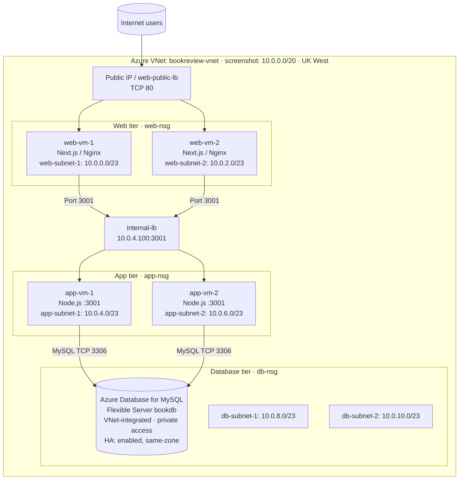
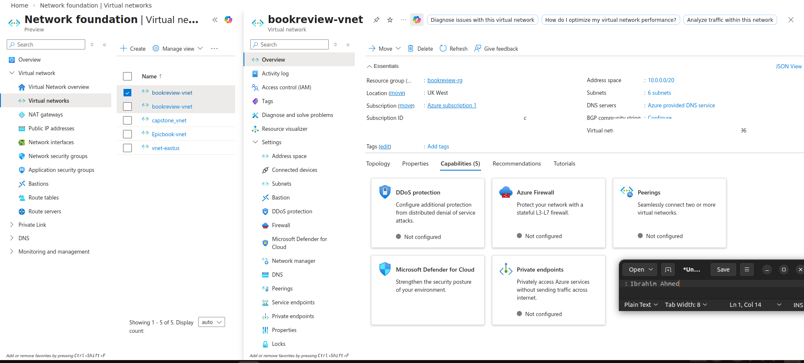
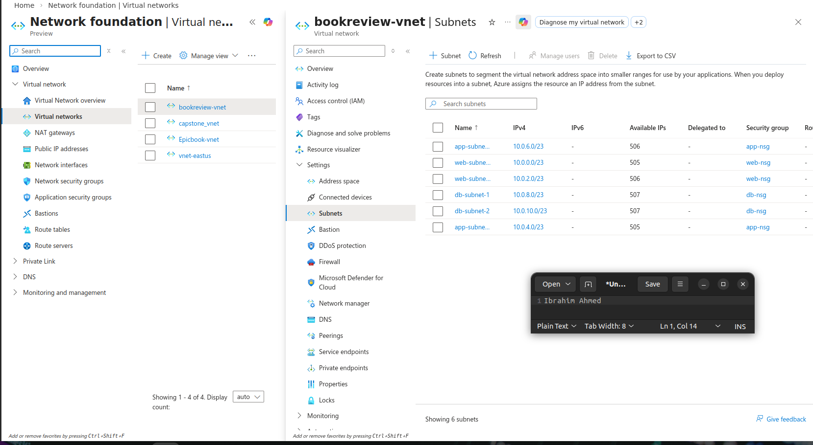
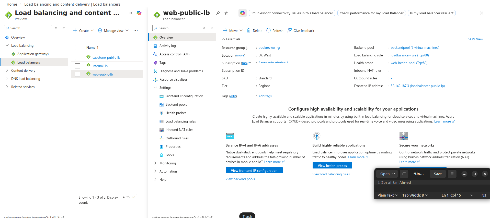
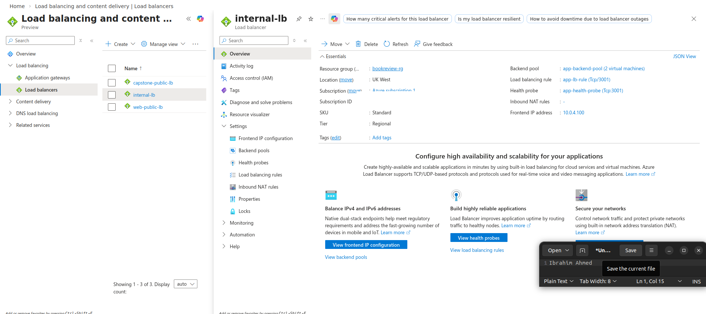
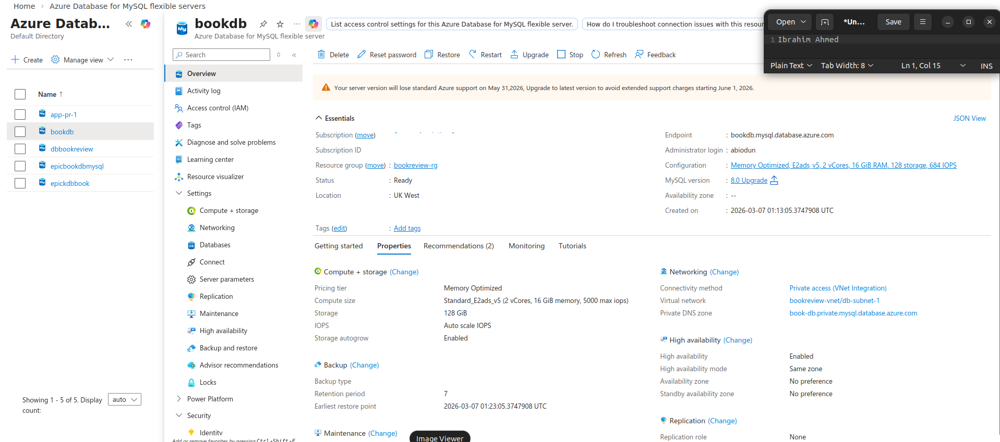
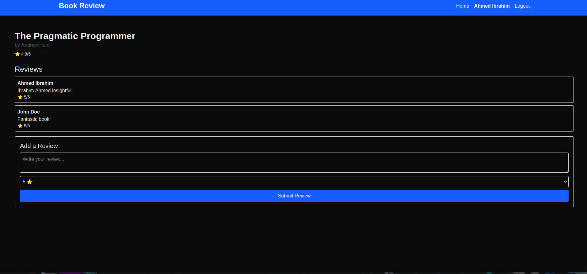

# Azure Three-Tier Book Review Application

**Microsoft Azure | Next.js | Node.js | Nginx | Azure Load Balancer | MySQL**
**DevOps Micro Internship (DMI), Cohort 2 — Week 8, Assignment 4**

## Overview

I deployed and documented a **three-tier Book Review application** on Microsoft Azure as part of my DevOps Micro Internship. The infrastructure separates a **web tier**, **application tier** and **database tier**, using Azure networking and security groups to manage communication between them. The report documents two web virtual machines, two application virtual machines, a public and an internal load balancer, and an Azure Database for MySQL Flexible Server.

**My contribution:** Azure infrastructure and network configuration, VM and application deployment, security group rules, load balancer setup, troubleshooting and deployment evidence. The Book Review application itself was provided for the internship; I do not claim original authorship of its source code.

## Architecture

**Address-space discrepancy:** The assignment text identifies the VNet as `10.0.0.0/16`, but the Azure VNet screenshot shows `10.0.0.0/20`. The subnet ranges listed below are within `/20`; this documentation preserves the discrepancy rather than presenting the two claims as identical.

**Request path:** Internet → `web-public-lb` → web VMs (Next.js / Nginx) → `internal-lb` (`10.0.4.100:3001`) → Node.js app VMs → private MySQL Flexible Server (`3306`).

The diagram reflects the reported topology. A Word screenshot confirms **private VNet integration** for MySQL. The database overview shows **high availability enabled in same-zone mode** and **replication role: None**; it does **not** verify a cross-zone standby or an operating read replica. More details: [Security and evidence limitations](docs/SECURITY_AND_LIMITATIONS.md).

## Azure infrastructure

| Component | Deployment documented in Week 8 |
|---|---|
| Azure region | UK West (visible on Azure Portal screenshots) |
| Virtual network | `bookreview-vnet` — **`10.0.0.0/20` in the Azure screenshot**; written assignment says `/16` |
| Web subnets | `web-subnet-1` `10.0.0.0/23`; `web-subnet-2` `10.0.2.0/23` |
| App subnets | `app-subnet-1` `10.0.4.0/23`; `app-subnet-2` `10.0.6.0/23` |
| Database subnets | `db-subnet-1` `10.0.8.0/23`; `db-subnet-2` `10.0.10.0/23` |
| Web tier | `web-vm-1`, `web-vm-2` — Next.js through Nginx on port `80` |
| Application tier | `app-vm-1`, `app-vm-2` — Node.js on port `3001` |
| Public load balancer | `web-public-lb` — traffic on port `80` |
| Internal load balancer | `internal-lb` — private frontend `10.0.4.100`, port `3001` |
| Database | Azure Database for MySQL Flexible Server `bookdb`, **private VNet access** |
| Network access | `web-nsg`, `app-nsg`, `db-nsg` provide tier-to-tier restrictions |

## Screenshots — original Word images

The screenshots were extracted **directly from the Week 8 Word (.docx) report, Assignment 4**, at their **embedded resolution** (roughly 1,900 pixels wide). They are not low-resolution PDF-page crops. Browser/account headers were trimmed and limited subscription identifiers redacted; **network and application evidence was not modified**. Click a screenshot to view it at full size.

| VNet overview | Six subnets |
|:---:|:---:|
|  |  |

| Public load balancer | Private internal load balancer |
|:---:|:---:|
|  |  |

| MySQL Flexible Server | Book Review application |
|:---:|:---:|
|  |  |

**Full screenshot gallery:** [13 screenshots with descriptions](screenshots/README.md) — includes NSG rules, web and app VM networking and VM inventory.

## Implementation highlights

- Segmented the Azure virtual network into **web, application and database subnets**, and configured tier-specific Network Security Groups.
- Set up `web-public-lb` to accept web traffic and `internal-lb` to route requests privately to the Node.js services.
- Deployed **two web VMs** and **two application VMs** and configured Nginx / Node.js services as recorded in the assignment.
- Connected the app tier to Azure Database for MySQL through private networking. The Azure portal evidence shows the database instance and networking properties.
- Verified the app interface in a browser and recorded infrastructure checks and configuration fixes.

## Troubleshooting

| Challenge | Resolution recorded in the report |
|---|---|
| Planning six subnet ranges | Calculated `/23` CIDR blocks within the `10.0.0.0/16` VNet. |
| VM backend pool associations | Added `web-vm-1`/`web-vm-2` to the public LB's web pool and `app-vm-1`/`app-vm-2` to the internal LB's application pool. |
| Restricting app-tier exposure | Kept the app VMs in private subnets behind `internal-lb` rather than using public IP addresses. |
| Database connectivity from app tier | Updated `db-nsg` to allow MySQL port `3306` from both application subnets. |

See [Troubleshooting](docs/TROUBLESHOOTING.md).

## Skills demonstrated

**Microsoft Azure:** Virtual Networks, subnet design, resource groups, VM provisioning, network security groups, public and internal load balancers, backend pools, probes, and Azure Database for MySQL Flexible Server.
**Systems and app deployment:** Linux/Ubuntu, Nginx, Node.js, Next.js application deployment, HTTP/TCP routing, database connectivity.
**DevOps and operations:** Cloud architecture documentation, connectivity troubleshooting, access controls, service verification, deployment evidence and Git/GitHub collaboration.

## Project files

- [`diagrams/architecture.mmd`](diagrams/architecture.mmd) — editable Mermaid architecture diagram.
- [`screenshots/`](screenshots/README.md) — original-resolution Azure screenshot evidence.
- [`docs/DEPLOYMENT_OVERVIEW.md`](docs/DEPLOYMENT_OVERVIEW.md) — architecture and networking overview without an assignment task list.
- [`docs/TROUBLESHOOTING.md`](docs/TROUBLESHOOTING.md) — challenges and solutions.
- [`docs/SECURITY_AND_LIMITATIONS.md`](docs/SECURITY_AND_LIMITATIONS.md) — source claims versus screenshot evidence.
- [`docs/REPOSITORY_SETUP.md`](docs/REPOSITORY_SETUP.md) — instructions for safely adding documentation to an existing source repo.

### Credit and evidence

**Original Book Review application:** [`pravinmishraaws/book-review-app`](https://github.com/pravinmishraaws/book-review-app) — the internship application source.
**Azure infrastructure implementation and documentation:** [@slim274](https://github.com/slim274), DMI Cohort 2.
**Evidence:** `IBRAHIM AHMED ABIODUN_Week8_GROUP2(1).docx`, **Assignment 4** (user-requested pages 34–44; the Assignment 4 heading and VNet setup begin on page 32 in the uploaded document). Screenshots represent the historical assignment, not proof of a currently running deployment. No automated recovery, cross-zone failover testing, CI/CD pipeline, TLS endpoint, or active read replica is asserted without evidence.
